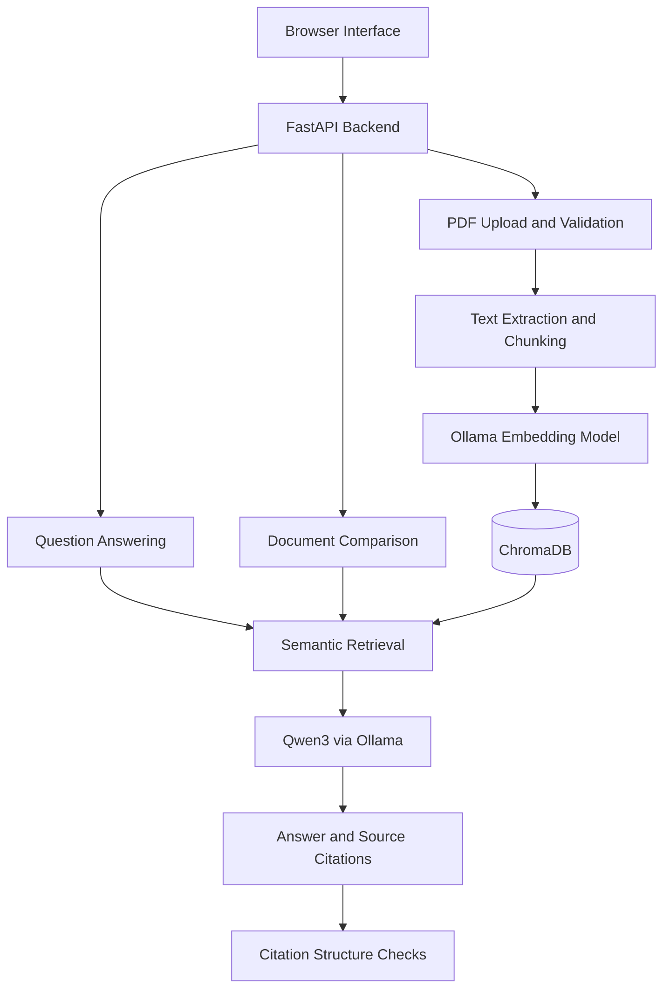

# NASA Mars Research Assistant

A locally running Retrieval-Augmented Generation (RAG) application for exploring and comparing Mars research papers.

The application uses local language models, semantic search and source citations to help users investigate scientific PDF documents.

## Features

- Upload and index PDF research papers (maximum 10 MB)
- Detect previously indexed PDFs using SHA-256 hashes
- Extract, chunk and embed PDF content
- Store embeddings persistently using ChromaDB
- Ask natural-language questions about indexed research
- Display retrieved source documents and page numbers
- Compare any two indexed research papers
- Validate comparison citation format and source coverage
- Interact through a browser interface or REST API

## Technology Stack

| Component | Technology |
|---|---|
| Backend | Python, FastAPI, Pydantic |
| PDF extraction | PyMuPDF |
| RAG orchestration | LangChain |
| Vector database | ChromaDB |
| Embedding model | nomic-embed-text |
| Language model | Qwen3 1.7B |
| Model runtime | Ollama |
| Frontend | HTML, CSS, JavaScript |
| Testing | unittest, FastAPI TestClient |

## Architecture



## Running Locally

### Prerequisites

- Python and pip
- Docker Desktop
- Git

The application is designed to run locally. No paid LLM API key is required.

### 1. Clone the repository

```powershell
git clone https://github.com/Rohan-HC/Nasa-Mars_RAG.git
cd Nasa-Mars_RAG
```

### 2. Create a Python virtual environment

```powershell
python -m venv venv
.\venv\Scripts\Activate.ps1
python -m pip install -r requirements.txt
```

### 3. Run Ollama using Docker

For a fresh installation:

```powershell
docker run -d --name nasa-ollama -p 11434:11434 -v nasa_ollama:/root/.ollama ollama/ollama
```

Download the models:

```powershell
docker exec nasa-ollama ollama pull nomic-embed-text
docker exec nasa-ollama ollama pull qwen3:1.7b
```

The application expects Ollama at:

`http://localhost:11434`

### 4. Start FastAPI

```powershell
python -m uvicorn api:app --reload
```

Open the application:

`http://127.0.0.1:8000/`

API documentation:

`http://127.0.0.1:8000/docs`

### 5. Upload your first PDF

Use the browser's Upload Research Paper section to upload a research PDF.

The application extracts its text, generates embeddings and stores the indexed passages in ChromaDB.

You can then ask questions or compare two different documents.

## Main API Endpoints

| Method | Endpoint | Purpose |
|---|---|---|
| GET | /health | Basic API health check |
| POST | /documents/upload | Upload and index a PDF |
| GET | /documents | List indexed documents |
| POST | /ask | Answer a research question |
| POST | /compare/documents | Compare two indexed documents |

## Automated Testing

Run the comparison citation and API tests:

```powershell
python -m unittest -v test_comparison_checks test_comparison_api
```

These tests check citation syntax, cross-document source coverage, request validation and API responses.

They use mocked comparison responses where appropriate, avoiding unnecessary LLM calls.

## Known Limitations

- Generated answers may contain unsupported scientific claims.
- Source citation validation checks structure and document coverage, not factual correctness.
- A small local language model may omit citations or incorrectly interpret evidence.
- PDF reference-section detection is heuristic and may not work for every document layout.
- Retrieval quality depends on document extraction, chunking and embedding quality.
- The application has not been hardened for public or multi-user deployment.
- Uploaded research documents and local vector data are excluded from version control.

All scientific claims should be checked against their original sources.

## Project Status

Functional local prototype with browser-based PDF ingestion, research question answering, document comparison and automated API tests.

Further work includes stronger groundedness evaluation, citation verification, security hardening and deployment automation.
