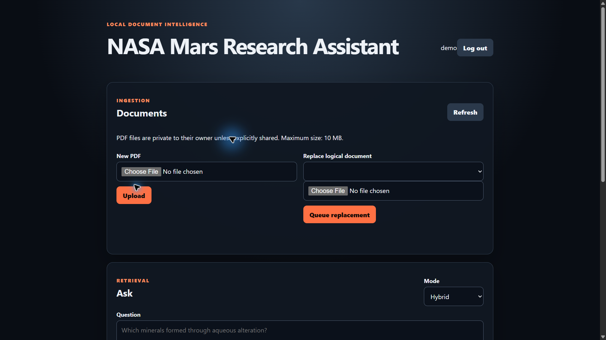
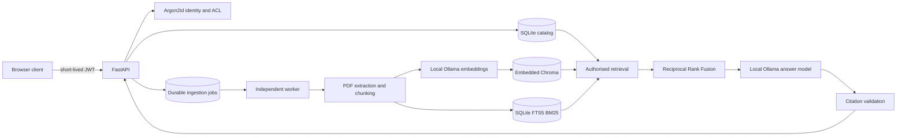

# NASA Mars Document Intelligence Service

[](https://github.com/Rohan-HC/Nasa-Mars_RAG/actions/workflows/ci.yml)

A local, multi-user document-intelligence service for NASA Mars research PDFs. It provides authenticated ingestion, owner-controlled document sharing, durable background indexing, dense/BM25 hybrid retrieval, evidence-linked answers, document comparison, and reproducible quality evaluation without paid APIs.

This repository is an engineering prototype for trusted local use. It is not hardened for direct public Internet exposure.

## Project preview



The browser workspace brings private PDF ingestion, hybrid retrieval, source-linked answers, and two-document comparison into one authenticated interface.

## Architecture



The relational catalog is authoritative for identity, access, active versions, chunks, and job state. Chroma and FTS5 are derived indexes. Retrieval receives a server-derived allowlist before either index is searched and rechecks returned chunk IDs against the active catalog before evidence reaches the model.

Replacement indexing is staged: the current version stays searchable while a new version is extracted, embedded, indexed, and verified. A catalog transaction then promotes the new version. Failed replacements leave the previous version active, and reconciliation removes stale derived data after safe promotion or deletion.

## Capabilities

- Argon2id password hashes and short-lived JWT bearer tokens; no default users or signing secrets.
- Owner-private documents with explicit reader grants and immediate revocation.
- Generic not-found responses that do not reveal another user's document or job identifiers.
- PDF signature, parseability, filename, page-count, and 10 MiB upload validation.
- HTTP `202 Accepted` ingestion and replacement with a separately restartable worker.
- Stable logical document IDs, immutable version IDs, SHA-256 duplicate detection, and idempotent jobs.
- Actual SQLite FTS5 `bm25()` keyword search, Chroma dense search, and deterministic RRF hybrid mode.
- Dense, keyword, and hybrid retrieval modes through the same permission-safe abstraction.
- Citation-format/existence validation kept separate from claim-level evidence support.
- Structured JSON logs with request/job IDs and stage timings, excluding prompts, document text, tokens, answers, and storage paths.
- Deterministic offline integration tests and an opt-in Ollama full-stack smoke test.

## Technology

Python 3.12, FastAPI, Pydantic, SQLAlchemy 2, Alembic, SQLite/FTS5, Chroma, LangChain, Ollama (`nomic-embed-text` and `qwen3:1.7b`), PyMuPDF, pytest, Ruff, Docker Compose, and GitHub Actions.

## Local setup

Prerequisites: Python 3.12 and [Ollama](https://ollama.com/) running locally.

```powershell
git clone https://github.com/Rohan-HC/Nasa-Mars_RAG.git
cd Nasa-Mars_RAG
python -m venv .venv
.venv\Scripts\Activate.ps1
python -m pip install -r requirements.txt
ollama pull nomic-embed-text
ollama pull qwen3:1.7b
$env:NASA_RAG_JWT_SECRET = python -c "import secrets; print(secrets.token_urlsafe(48))"
alembic upgrade head
python -m nasa_rag.cli create-user --username alice
```

Run the API and worker in separate terminals with the same environment:

```powershell
python -m uvicorn api:app --host 127.0.0.1 --port 8000
```

```powershell
python -m nasa_rag.worker
```

Open `http://127.0.0.1:8000`, sign in, upload a PDF, and wait for the job to become `succeeded` before querying it. Configuration placeholders and retrieval settings are listed in `.env.example`; the application reads environment variables directly and does not load that file automatically.

### Docker Compose

Ollama remains on the host so model files are not duplicated inside containers.

```powershell
$env:NASA_RAG_JWT_SECRET = python -c "import secrets; print(secrets.token_urlsafe(48))"
docker compose up --build -d
docker compose exec api python -m nasa_rag.cli create-user --username alice
```

The service binds only to `127.0.0.1:8000`. API and worker share the catalog, upload, and Chroma volume. Stop the stack with `docker compose down`; add `--volumes` only when intentionally deleting all local application data.

## API workflow

Interactive schemas are at `/docs`. A minimal PowerShell flow is:

```powershell
$login = Invoke-RestMethod -Method Post -Uri http://127.0.0.1:8000/auth/token `
  -ContentType application/json -Body '{"username":"alice","password":"your-password"}'
$headers = @{ Authorization = "Bearer $($login.access_token)" }

$upload = Invoke-RestMethod -Method Post -Uri http://127.0.0.1:8000/documents/upload `
  -Headers $headers -Form @{ file = Get-Item .\mars-report.pdf }

Invoke-RestMethod -Uri "http://127.0.0.1:8000/jobs/$($upload.job_id)" -Headers $headers

$body = @{
  question = "What evidence describes the crater geology?"
  document_ids = @($upload.document_id)
  retrieval_mode = "hybrid"
} | ConvertTo-Json
Invoke-RestMethod -Method Post -Uri http://127.0.0.1:8000/ask `
  -Headers $headers -ContentType application/json -Body $body
```

Important authenticated endpoints:

| Method and path | Purpose |
|---|---|
| `POST /auth/token` | Exchange local credentials for a short-lived token |
| `GET /auth/me` | Read the current identity |
| `GET /documents` | List only accessible documents |
| `POST /documents/upload` | Validate, persist, queue, and return `202` |
| `PUT /documents/{id}/content` | Queue an owner-only replacement and return `202` |
| `GET /jobs/{id}` | Read an owner-only ingestion job |
| `PUT /documents/{id}/permissions/{username}` | Grant reader access as owner |
| `DELETE /documents/{id}/permissions/{username}` | Revoke reader access as owner |
| `POST /ask` | Query authorised active versions |
| `POST /compare/documents` | Compare two authorised documents |
| `DELETE /documents/{id}` | Delete as owner and clean derived data |
| `GET /health/live` | Process liveness; no dependency guarantee |
| `GET /health/ready` | Catalog, vector store, Ollama, and model readiness |

## Tests and quality gates

All CI tests are offline: deterministic embeddings/models and synthetic PDFs replace Ollama and private NASA files.

```powershell
python -m pip install -r requirements-dev.txt
python -m pip check
ruff check api.py nasa_rag evaluation tests logging_config.py health_checks.py rag_nasa.py document_comparison.py compare_nasa.py retrieval_embeddings.py migrations
alembic upgrade head
python -m pytest -q
```

An explicit full-stack test exercises authentication, asynchronous PDF ingestion, the worker, hybrid retrieval, and Ollama:

```powershell
$env:NASA_RAG_FULL_STACK = "1"
$env:NASA_RAG_SMOKE_USERNAME = "alice"
$env:NASA_RAG_SMOKE_PASSWORD = "your-password"
python -m pytest -q tests/test_full_stack.py
```

The GitHub Actions workflow also verifies upgrade/downgrade/upgrade migrations, runs an API smoke test, inventories dependency licenses, and audits known vulnerabilities.

## Evaluation

The original 20-case V1 dataset and historical outputs remain unchanged. Those historical results used citation-label validation and a lexical evidence proxy; they must not be interpreted as semantic entailment:

| Historical V1 measure | Baseline | Post-citation |
|---|---:|---:|
| Retrieval Hit@4 | 94.1% | 94.1% |
| Answer correctness | 70.0% | 65.0% |
| Citation label validity | 95.0% | 100.0% |
| Lexical evidence proxy | 64.7% | 58.8% |
| Mean latency | 10.221 s | 23.262 s |

V2 adds auditable claim units, unsupported/paraphrased claims, misleading citations, synthesis, abstentions, and ambiguous outcomes. Its deterministic nine-case synthetic scorer fixture currently produces 6/7 supported evaluable claims (85.7%), 4/8 citation precision (50.0%), 4/8 citation coverage (50.0%), and 2/2 correct refusals. These validate scoring behavior, not NASA answer quality or application performance. One ambiguous claim is excluded from the faithfulness denominator. Fixture latency values are test inputs, not measured service latency.

Run the deterministic V2 fixture:

```powershell
python -m evaluation.v2_run --dataset evaluation/datasets/document_intelligence_eval_v2.json
```

The optional Ollama semantic judge is not a ground-truth oracle and has not been used to publish a live NASA benchmark in this repository. Live results require locally available source PDFs, explicit provenance, and human review. Dense-versus-hybrid application quality and p50/p95 latency are not yet measured; a deterministic retrieval unit fixture demonstrates fusion behavior only.

## Reliability and security boundaries

- Access is denied by default and enforced before both dense and BM25 retrieval, then revalidated against active catalog rows. Model output and client-supplied owner IDs never grant access.
- SQLite transactions and worker leases provide durable single-host job recovery. This design is not a horizontally scalable distributed queue and SQLite/Chroma do not provide distributed atomic transactions.
- Staged activation preserves the previous answerable version on extraction, Ollama, or index failures. Derived-store reconciliation is idempotent but should still be backed up and monitored for important data.
- JWTs have short expirations but no refresh-token or per-token revocation store. Disabling a user is checked on every authenticated request. Rate limits are in-memory and therefore per API process.
- There is no TLS termination, malware scanning, OCR, sandboxed PDF parser, enterprise identity provider, or public-service abuse protection. Place a reviewed reverse proxy and stronger operational controls in front of any non-local deployment.
- PDF text and embedded instructions are untrusted evidence. Prompts instruct the model not to follow document commands, and regression tests cover prompt-injection text, but model-level prompt injection cannot be guaranteed away.
- Chroma 1.5.9 has published 2026 advisories for its HTTP server with no fixed version listed at the time of this release check. This application uses only embedded `PersistentClient` and does not start or expose Chroma's server; CI exceptions are limited to those four IDs and any new advisory fails the audit. Upgrade immediately when a compatible fix is available.
- PyMuPDF is dual-licensed under AGPL-3.0 or a commercial Artifex license. Anyone distributing or operating a modified network service must review and satisfy those terms; this repository does not claim permissive-license compatibility.
- Generated answers can still be wrong. Citation syntax, citation existence, and semantic claim support are separate measurements; a real citation label alone is not proof of factual correctness.

Do not commit `.env`, tokens, users, uploaded PDFs, SQLite databases, Chroma data, model caches, or private evaluation annotations.
