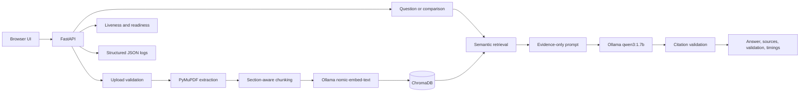

# NASA Mars Research Assistant

[](https://github.com/Rohan-HC/Nasa-Mars_RAG/actions/workflows/ci.yml)

A local Retrieval-Augmented Generation (RAG) application for asking questions about NASA Mars research papers and comparing evidence across documents. It combines a FastAPI backend, PDF ingestion, Chroma vector search, local Ollama models, source citations, deterministic validation, and a browser interface.

The project is designed as a transparent engineering prototype: it runs without paid APIs, exposes its quality measurements, and distinguishes citation structure from factual grounding.

## What it does

- Uploads PDF research papers up to 10 MB.
- Validates that uploads are readable PDFs before indexing.
- Extracts text, detects reference sections, and creates overlapping chunks.
- Generates local `nomic-embed-text` embeddings through Ollama.
- Stores chunks and metadata in a persistent Chroma collection.
- Detects duplicate documents by SHA-256 and versioned chunk IDs.
- Retrieves relevant passages for natural-language questions.
- Generates answers with local `qwen3:1.7b` and numeric source citations.
- Compares two selected documents using source labels such as `[S1]`.
- Rejects missing, malformed, or nonexistent citation labels.
- Returns controlled refusals when generated citation validation fails.
- Reports retrieval, model, and end-to-end timing.
- Provides separate liveness and dependency-aware readiness checks.
- Runs a portable offline test suite in GitHub Actions.
- Includes a 20-case, source-referenced evaluation dataset and machine-readable results.

## Architecture



### Request flow

1. FastAPI and Pydantic validate request shape and length.
2. Retrieval embeds the query and searches only chunks marked as document content.
3. Retrieved passages are labelled and placed in an evidence-only prompt.
4. The local model generates an answer.
5. Citation validation checks syntax, source existence, and comparison coverage.
6. Invalid generated answers are replaced with an insufficient-evidence response.
7. The API returns the answer, retrieved source metadata, validation state, and timings.

Citation validation is deliberately narrow. A valid citation label means the source was retrieved and the label exists; it does **not** prove that the claim is entailed by the source.

## Technology stack

| Area | Technology |
|---|---|
| API and validation | Python, FastAPI, Pydantic |
| PDF processing | PyMuPDF |
| RAG integration | LangChain |
| Vector database | ChromaDB |
| Embeddings | `nomic-embed-text` through Ollama |
| Language model | `qwen3:1.7b` through Ollama |
| Frontend | HTML, CSS, JavaScript |
| Testing | pytest, FastAPI TestClient, deterministic fakes |
| CI | GitHub Actions on Python 3.12 |

## Repository structure

```text
.
|-- api.py                     # FastAPI routes, middleware, error responses
|-- rag_nasa.py                # Question-answering RAG flow
|-- document_indexer.py        # PDF extraction, chunking, duplicate-safe indexing
|-- document_comparison.py     # Two-document comparison flow
|-- citation_validation.py     # Citation syntax and source checks
|-- rag_runtime.py             # Ollama/retrieval error translation
|-- health_checks.py           # Readiness dependency checks
|-- logging_config.py          # Structured JSON logging
|-- evaluation/                # Dataset, metrics, runner, reports, source verifier
|-- tests/                     # Portable offline tests
|-- web/index.html             # Browser interface
`-- .github/workflows/ci.yml   # Offline CI workflow
```

## Local setup

### Prerequisites

- Git
- Python 3.12
- Docker Desktop, or an existing Ollama installation

No paid API key is required.

### 1. Clone and install

```powershell
git clone https://github.com/Rohan-HC/Nasa-Mars_RAG.git
cd Nasa-Mars_RAG

python -m venv .venv
.\.venv\Scripts\Activate.ps1
python -m pip install --upgrade pip
python -m pip install -r requirements.txt
```

For development and tests, install `requirements-dev.txt` instead; it includes the application requirements.

```powershell
python -m pip install -r requirements-dev.txt
```

### 2. Start Ollama and download the models

```powershell
docker run -d --name nasa-ollama -p 11434:11434 -v nasa_ollama:/root/.ollama ollama/ollama
docker exec nasa-ollama ollama pull nomic-embed-text
docker exec nasa-ollama ollama pull qwen3:1.7b
```

The application expects Ollama at `http://localhost:11434`.

### 3. Start the API

```powershell
python -m uvicorn api:app --reload
```

- Browser interface: `http://127.0.0.1:8000/`
- OpenAPI documentation: `http://127.0.0.1:8000/docs`
- Liveness: `http://127.0.0.1:8000/health/live`
- Readiness: `http://127.0.0.1:8000/health/ready`

Readiness succeeds only when the Chroma path exists, Ollama responds, and both required models are installed.

## API examples

### Upload a PDF

```bash
curl -X POST http://127.0.0.1:8000/documents/upload \
  -F "file=@mars-paper.pdf;type=application/pdf"
```

### List indexed documents

```bash
curl http://127.0.0.1:8000/documents
```

### Ask a question

```bash
curl -X POST http://127.0.0.1:8000/ask \
  -H "Content-Type: application/json" \
  -d '{"question":"Which minerals formed through aqueous alteration?"}'
```

Successful RAG responses contain:

- `answer`
- `retrieved` source metadata and passage text
- `validation.citation_valid`
- `validation.factual_grounding`
- `timings_ms.retrieval`, `model`, and `total`

### Compare two documents

Use SHA-256 identifiers returned by `/documents`:

```bash
curl -X POST http://127.0.0.1:8000/compare/documents \
  -H "Content-Type: application/json" \
  -d '{
    "document_a":"<64-character-sha256>",
    "document_b":"<64-character-sha256>",
    "question":"Compare the geological interpretations in these papers."
  }'
```

### Error contract

Expected failures use a stable envelope and include a correlation ID:

```json
{
  "error": {
    "code": "model_timeout",
    "message": "The local language model timed out",
    "request_id": "<request-id>"
  }
}
```

The same ID is returned in the `X-Request-ID` response header. `X-Response-Time-Ms` contains API end-to-end time.

## Automated testing and CI

The portable suite uses generated PDFs and deterministic fakes for Chroma, embeddings, and model generation. It does not require Ollama, local research PDFs, a populated vector database, network access, or secrets.

```powershell
python -m pytest -q
```

Verified local result for this milestone:

```text
47 passed
```

GitHub Actions installs `requirements-dev.txt` on Python 3.12 and runs the same command for pushes and pull requests.

The test suite covers:

- API and Pydantic validation
- valid, malformed, and oversized uploads
- duplicate detection and failed-index recovery
- mocked embeddings and model calls
- missing, malformed, unknown, and cross-document citations
- controlled refusals for unsupported generated output
- liveness and readiness behavior
- timeout and connection-failure translation
- predictable error envelopes
- structured logging and timing metadata
- prompt-injection containment at the prompt boundary
- evaluation dataset and metric behavior

Legacy root-level diagnostic scripts are not part of CI because some intentionally use local ignored PDFs or a live Chroma/Ollama environment. CI collects tests only from `tests/`.

## RAG evaluation

The committed dataset at `evaluation/datasets/mars_eval_v1.json` contains 20 cases:

- 9 factual retrieval questions
- 4 multi-evidence questions
- 3 document comparisons
- 2 unanswerable questions
- 2 hallucination-prone questions

Seventeen positive cases identify a document SHA-256 and one or more verified PDF pages. Three negative cases require refusal and were reviewed for absence from the three-document benchmark corpus.

### Metrics

| Metric | Meaning |
|---|---|
| Retrieval Hit@K | At least one expected source page was returned |
| Source Recall@K | Fraction of expected source references returned |
| Answer correctness | Required benchmark concepts appeared in the answer |
| Citation validity | Citation format and label existence were valid |
| Evidence support | Required concepts appeared in the cited retrieved passages |
| Correct refusal | An unanswerable/false-premise question received the configured refusal |
| Response latency | End-to-end evaluation call time |

Correctness and evidence support are deterministic lexical proxies, not semantic proof or an LLM judge.

### Measured results

These are single live runs against the local three-document Chroma index and local `qwen3:1.7b`. They are reproducible artifacts, not performance guarantees; model output and local latency vary between runs.

| Metric | Baseline | After citation enforcement |
|---|---:|---:|
| Retrieval Hit@4 | 94.1% | 94.1% |
| Source Recall@4 | 94.1% | 94.1% |
| Answer correctness | 70.0% | 65.0% |
| Citation validity | 95.0% | 85.0% |
| Evidence-supported answers | 64.7% | 58.8% |
| Correct refusal | 100.0% | 100.0% |
| Mean response latency | 10.221 s | 23.262 s |

The post-validation run did not demonstrate a general quality or speed improvement. It did demonstrate safer failure behavior: two comparison generations that failed citation requirements were withheld and replaced with an insufficient-evidence response. A stricter prompt experiment was reverted after it reduced measured correctness and increased latency.

Full artifacts:

- `evaluation/results/baseline.json` and `baseline.md`
- `evaluation/results/post_citation.json` and `post_citation.md`

Run the benchmark:

```powershell
python -m evaluation.run
```

This requires a live local index and both Ollama models. It overwrites the default baseline output paths unless different `--output` and `--report` paths are supplied.

If the three source PDFs are available under `data/`, verify positive cases against the declared hashed PDF pages:

```powershell
python -m evaluation.verify_sources
```

The research PDFs and local vector data are intentionally excluded from Git, so source verification cannot run from a clean clone until the matching documents are supplied and indexed.

## Reliability and observability

- Model calls have a 120-second client timeout.
- Embedding calls have a 30-second client timeout.
- Connection and timeout failures map to stable API error codes.
- Failed indexing removes the temporary upload.
- Re-indexing preserves the previous version until new chunk IDs verify.
- Duplicate uploads do not leave redundant PDF copies.
- Every API response includes a request ID and end-to-end response time.
- RAG operations log retrieval, model, and total latency as structured JSON.
- Logs include operational metadata, not questions, prompts, or document passages.

## Security considerations

Uploaded content is treated as untrusted evidence, not instructions. The system prompt reinforces this boundary, and tests verify that document prompt-injection text remains in the evidence message rather than the system message.

Additional controls include:

- 10 MB streaming upload limit
- PDF extension and parser validation
- UUID-based storage paths rather than user filenames
- 1,000-character question limits
- generic internal error responses without exception details
- cleanup after invalid files and failed indexing

This is a local, unauthenticated application. It does not provide authentication, authorization, tenant isolation, rate limiting, TLS termination, malware scanning, or a hardened parser sandbox. Do not expose it directly to the public internet. Prompt injection cannot be eliminated solely with prompting; retrieved evidence and model answers must remain untrusted.

## Known limitations

- A valid citation ID does not guarantee factual correctness or entailment.
- The small local model can omit concepts, choose the wrong retrieved passage, or produce unsupported claims.
- Retrieval is dense semantic search without a reranker or hybrid keyword stage.
- PDF reference-section detection is heuristic.
- Scanned PDFs require OCR outside the current ingestion path.
- Tables, figures, and complex layouts may lose information during text extraction.
- The lexical evaluation metrics do not capture paraphrases perfectly.
- The 20-case benchmark covers three documents and is not a broad scientific QA benchmark.
- Chroma persistence is intended for local single-user operation, not concurrent multi-tenant service.
- Latency depends heavily on local hardware, model warm state, and document context size.
- NASA PDFs and generated local vector data are not distributed in the repository.

## Demonstration checklist

1. Start Ollama and confirm `/health/ready` returns `ready`.
2. Start FastAPI and open the browser interface.
3. Upload one PDF and show the returned SHA-256, page count, and chunk count.
4. Upload the same PDF again and show `already_indexed`.
5. Ask a factual question and inspect the answer, source pages, validation, and timings.
6. Upload a second paper and compare the two SHA-256 document IDs.
7. Submit an unanswerable question and show the controlled refusal.
8. Run `python -m pytest -q` to demonstrate the offline suite.
9. Open the evaluation reports and explain one retrieval failure separately from one answer-generation failure.

## Project status

This repository is a tested local applied-AI/backend engineering project. It demonstrates PDF ingestion, vector retrieval, local model integration, evaluation, citation enforcement, failure handling, structured observability, and CI. It has not been deployed or validated as a production, public, or safety-critical service.
